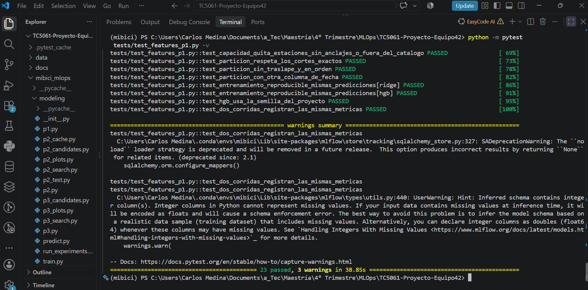
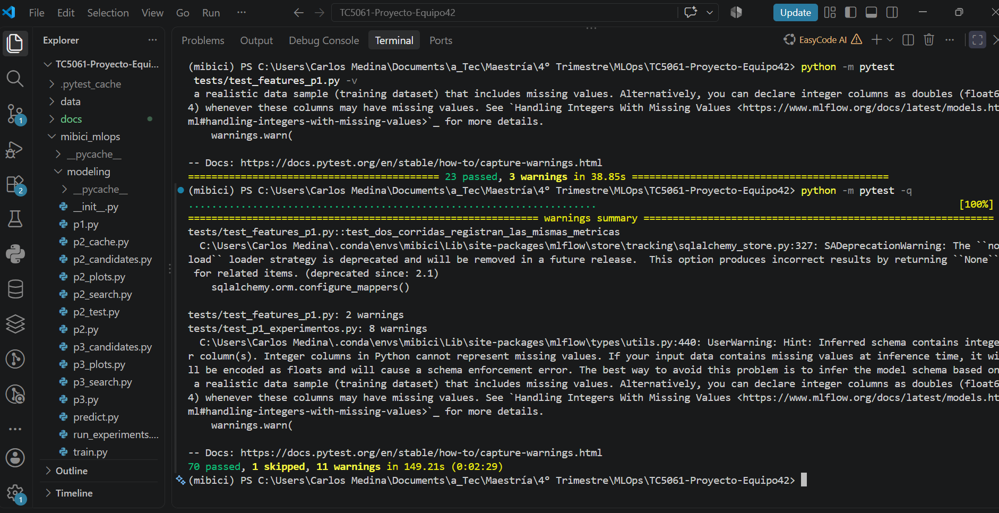
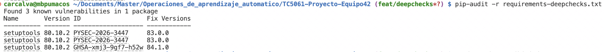
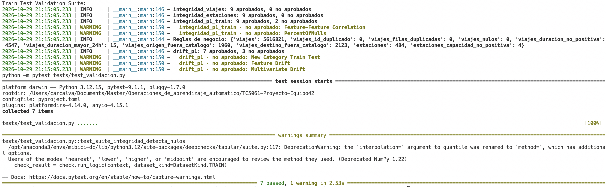
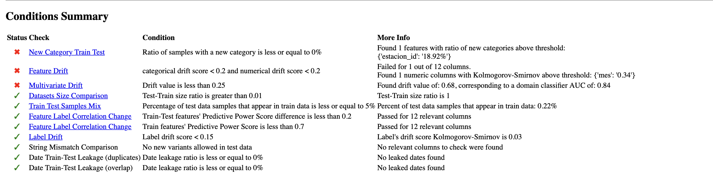
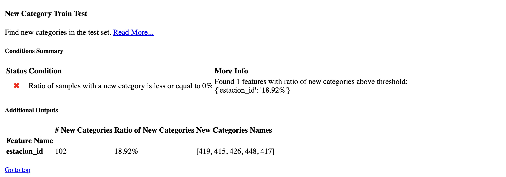
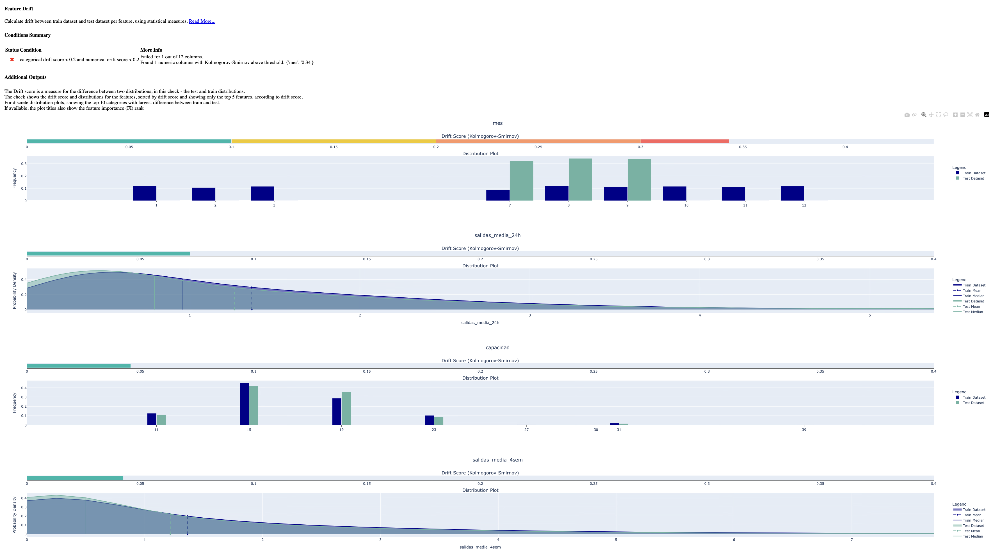
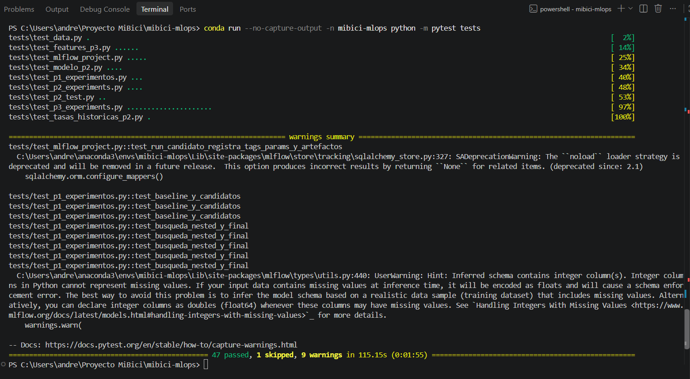
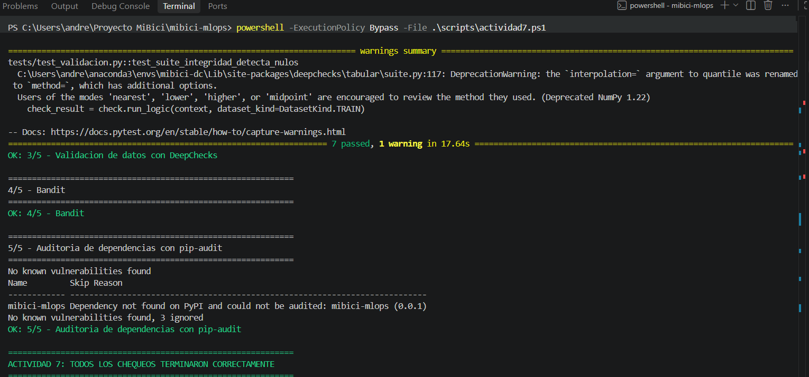
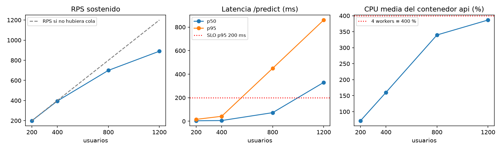

# MiBici MLOps · TC5061 Equipo 42

<a target="_blank" href="https://cookiecutter-data-science.drivendata.org/">
    
</a>
[](https://github.com/a01797754-dotAPML/TC5061-Proyecto-Equipo42/actions/workflows/ci.yml)

Pipeline reproducible de Machine Learning sobre los datos abiertos de **MiBici**, el sistema de bicicleta pública del Área Metropolitana de Guadalajara. Proyecto integrador final de TC5061 Operaciones de Aprendizaje Automático (Tecnológico de Monterrey): un sistema de ML de punta a punta, desde la ingesta hasta un modelo trazable sirviendo predicciones, con CI/CD, monitoreo y gobernanza.

## Proyecto final: dónde está cada componente

El sistema predice cuántos viajes iniciarán en cada estación en la siguiente hora (P1) y lo sirve con una API. Este README se fue construyendo por actividad; esta tabla junta los componentes de la entrega final.

| Componente | Dónde está |
|---|---|
| Estructura Cookiecutter Data Science | Sección "Estructura del repositorio" |
| Ingesta versionada y feature engineering | `mibici_mlops/dataset.py`, `mibici_mlops/features.py`, `data_manifest.json` |
| Código como MLflow Project | `MLproject`, `python_env.yaml`, sección "MLflow Project (entrega 2)" |
| Seguimiento de experimentos (MLflow Tracking) | `mibici_mlops/tracking.py`, [`docs/MODEL_REGISTRY.md`](docs/MODEL_REGISTRY.md) §1–2, `docs/evidencias/actividad11_experimentos_p1.csv` |
| Model Registry, linaje y estado de producción | [`docs/MODEL_REGISTRY.md`](docs/MODEL_REGISTRY.md) |
| API con FastAPI y contenedor | `mibici_mlops/api/`, `Containerfile`, sección "Servicio de inferencia con FastAPI y contenedor — Actividad 8" |
| Orquestación con Docker Compose | `compose.yaml`, [`DEPLOYMENT.md`](DEPLOYMENT.md) |
| CI/CD con GitHub Actions | `.github/workflows/ci.yml`, [`docs/CI_CD.md`](docs/CI_CD.md) |
| Pruebas de carga con Locust | `load_tests/locustfile.py`, sección "Operación, pruebas de carga y FinOps — Actividad 10" |
| Reporte de drift con Evidently | [`docs/EVIDENTLY_DATA_DRIFT_P1.md`](docs/EVIDENTLY_DATA_DRIFT_P1.md) |
| A/B testing entre versiones | `mibici_mlops/monitoring/ab_test_p1.py`, [`docs/AB_TEST_P1.md`](docs/AB_TEST_P1.md) |
| Análisis FinOps | Sección "Operación, pruebas de carga y FinOps — Actividad 10", §6 |
| Model Card | [`MODEL_CARD.md`](MODEL_CARD.md) |

Para levantar el sistema completo en un clon limpio: `docker compose up -d --build` y luego `POST http://localhost:8000/predict` (ver [`DEPLOYMENT.md`](DEPLOYMENT.md)).

## Propósito

Responder con Machine Learning tres preguntas sobre la operación de MiBici y dejar una base reproducible: ingesta versionada, variables sin información del futuro, baselines registrados en MLflow y un flujo de trabajo en equipo con Pull Requests. La propuesta completa está en el ML Canvas ([`references/ml_canvas.md`](references/ml_canvas.md)) y la arquitectura en [`references/arquitectura.png`](references/arquitectura.png).

## Preguntas del proyecto

| # | Pregunta | Tarea | Formulación | Usuario |
|---|---|---|---|---|
| P1 | ¿Cuántos viajes iniciarán en una estación en la siguiente hora? | Regresión | Salidas por estación × hora, horizonte 1 h | Operador del sistema |
| P2 | ¿La estación se quedará sin bicis o sin anclajes? | Clasificación (3 clases) | Flujo neto de la hora / capacidad: < −0.30 desabasto, > +0.30 saturación; horizonte 1 h | Equipo de rebalanceo |
| P3 | ¿Qué grupos de estaciones comparten patrones de uso? | Clustering | Perfil horario de salidas y llegadas (entre semana y fin de semana) + flujo neto relativo | Planeación urbana |

## Datos

- **Fuente:** [portal de datos abiertos de MiBici](https://www.mibici.net/es/datos-abiertos/): viajes mensuales en CSV y nomenclatura de estaciones (`nomenclatura_2026_09.csv`). Las URLs exactas de cada mes están en `mibici_mlops/config.py`.
- **Rango:** 15 meses, de julio de 2025 a septiembre de 2026 → **5,616,821 viajes** (tras eliminar 758 duplicados) y **484 estaciones**.
- **Partición temporal:** entrenamiento jul-2025 a mar-2026 · validación abr a jun-2026 · test jul a sep-2026 (fechas de corte en `config.py`).
- **Versionado:** `data_manifest.json` (en Git) guarda número de registros y SHA-256 de cada archivo crudo y procesado; su hash es el `data_version` que se registra en MLflow.
- **Datos personales:** la ingesta solo lee 5 columnas (viaje, inicio, fin, origen, destino); `Usuario_Id`, `Genero` y `Año_de_nacimiento` nunca se leen ni se guardan.
- **Uso:** el portal no publica una licencia abierta explícita; los datos se usan con fines académicos y **no se redistribuyen** (están en `.gitignore`; se descargan con `make data`).

## Estructura del repositorio

```
├── MLproject                <- MLflow Project: puntos de entrada ingest y train
├── python_env.yaml          <- Entorno del MLflow Project (mismas versiones que requirements.txt)
├── Makefile                 <- make requirements | data | experiments | test | lint
├── README.md
├── data_manifest.json       <- Versión de los datos (registros + SHA-256 por archivo)
├── pyproject.toml           <- Metadatos del paquete mibici_mlops y configuración de ruff
├── requirements.txt         <- Dependencias con versión fija (Python 3.12)
├── data/                    <- Fuera de Git: raw/ (CSV originales) y processed/ (Parquet)
├── docs/                    <- Proyecto mkdocs de la plantilla
├── models/                  <- Modelos serializados (fuera de Git)
├── notebooks/               <- Solo exploración: 1.0-ce-exploracion-mibici.ipynb
├── references/              <- ML Canvas (md, png, html) y diagrama de arquitectura (png, dot)
├── reports/figures/         <- Figuras generadas por los experimentos (fuera de Git)
├── tests/                   <- Pruebas de ingesta, features de P3, modelo P2 y registro común / MLflow Project (pytest)
└── mibici_mlops/            <- Código fuente
    ├── config.py            <- Rutas, fechas, partición, semilla, URLs y MLflow (un solo lugar)
    ├── dataset.py           <- Ingesta: descarga, normalización y Parquet
    ├── manifest.py          <- Genera data_manifest.json
    ├── features.py          <- Tabla estación × hora, calendario, rezagos, etiqueta P2, perfiles P3
    ├── tracking.py          <- Registro común en MLflow: registrar_run (baselines), iniciar_run + registrar_resultados (candidatos)
    ├── preparar_p2.py, modelo_p2.py, entrenar_p2.py   <- Preparación, modelo y entrenamiento de P2
    └── modeling/
        ├── p1.py, p2.py, p3.py      <- main() (baseline) y train(model, params) (candidatos, entrega 2)
        ├── train.py                 <- Punto de entrada train del MLflow Project
        └── run_experiments.py       <- Orquesta P1, P2 y P3 (make experiments)
```

## Instalación

Requiere Python 3.12, `make` y `curl`.

```bash
git clone https://github.com/a01797754-dotAPML/TC5061-Proyecto-Equipo42.git
cd TC5061-Proyecto-Equipo42
conda create -n mibici python=3.12 -y && conda activate mibici   # o un venv con Python 3.12
make requirements                                                # instala dependencias fijas + el paquete
```

## Ingesta de datos

```bash
make data
```

Descarga los 15 meses y la nomenclatura, normaliza codificación, columnas y fechas, elimina duplicados, guarda Parquet en `data/processed/` y regenera `data_manifest.json`. Desde un clon limpio, el manifiesto resulta idéntico al versionado (`data_version = 2a196cfa2823`).

## Experimento base

```bash
make experiments                                                # P1, P2 y P3 → experimento mibici-equipo42
python -m mibici_mlops.modeling.run_experiments --pregunta P2   # una sola pregunta (repetible)
python -c "from mibici_mlops.modeling import p3; p3.main_pca()" # candidato P3: PCA + KMeans
python -m mlflow ui --backend-store-uri sqlite:///mlflow.db     # interfaz en http://127.0.0.1:5000
```

`make experiments` se niega a correr con cambios sin commitear (salvo `--permitir-cambios`), sigue con las demás preguntas si una falla y termina con código 1 si hubo errores. Usar `python -m mlflow` garantiza la versión de MLflow del entorno.

| Run | Métricas de test |
|---|---|
| `p1-baseline-semana-anterior` | MAE 0.942 · RMSE 1.921 |
| `p2-baseline-semana-anterior` | macro-F1 0.473 · recall desabasto 0.182 · recall saturación 0.243 |
| `p2-random-forest` | macro-F1 0.512 · recall desabasto 0.382 · recall saturación 0.458 |
| `p3-baseline-kmeans` | silhouette 0.074 · Davies-Bouldin 3.05 · ARI 0.686 |
| `p3-pca-kmeans` | silhouette 0.095 · Davies-Bouldin 2.72 · ARI 0.633 |

Pruebas: `make test` (o `python -m pytest tests`).

## MLflow Project (entrega 2)

El repositorio es un **MLflow Project** (`MLproject` en la raíz): la ingesta y el entrenamiento de P1, P2 y P3 se ejecutan con `mlflow run`. El entorno se declara en `python_env.yaml` con las mismas versiones fijas de `requirements.txt`; `mlflow run` lo crea con **pyenv** (`brew install pyenv && pyenv install 3.12.15`).

### 1. Servidor de tracking (requerido por el Model Registry)

En una terminal aparte, desde la raíz del repo:

```bash
python -m mlflow server --backend-store-uri sqlite:///mlflow.db --port 5000
```

Y en la terminal de trabajo:

```bash
export MLFLOW_TRACKING_URI=http://127.0.0.1:5000
```

`config.py` toma `MLFLOW_TRACKING_URI` de esta variable (si no existe, usa `sqlite:///mlflow.db`). `mlflow.db`, `mlruns/` y `mlartifacts/` están en `.gitignore`. Usar `python -m mlflow` garantiza la versión de MLflow del entorno.

### 2. Ingesta y entrenamiento con `mlflow run`

```bash
# Ingesta: descarga, normaliza y versiona los datos (dataset.py + manifest.py)
python -m mlflow run . -e ingest --experiment-name mibici-equipo42

# Entrenamiento de un candidato: pregunta, modelo e hiperparámetros (JSON)
python -m mlflow run . -e train --experiment-name mibici-equipo42 \
    -P question=<p1|p2|p3> -P model=<modelo> -P params='{"<hiperparametro>": <valor>}'
```

| Parámetro | Valores | Por defecto |
|---|---|---|
| `question` | `p1`, `p2`, `p3` | `p1` |
| `model` | Los que implementa cada `modeling/pN.py` | Obligatorio |
| `params` | Hiperparámetros en JSON | `{}` (valores por defecto del modelo) |

Rutas, fechas, partición y semilla salen de `config.py`; no se pasan por parámetro. Para probar sin MLflow Project: `python -m mibici_mlops.modeling.train --question <p1|p2|p3> --model <modelo>`.

**Contrato por pregunta:** cada `mibici_mlops/modeling/pN.py` expone `train(model: str, params: dict) -> str` (devuelve el `run_id`) y registra la corrida con `tracking.iniciar_run` + `tracking.registrar_resultados`. El ejemplo de uso completo está en `tests/test_mlflow_project.py`.

### 3. Qué registra cada candidato

Cada corrida candidata reutiliza el run que crea `mlflow run` y registra, con el helper común `tracking.iniciar_run` + `tracking.registrar_resultados`:

| Elemento | Dónde |
|---|---|
| Etiquetas `equipo`, `question`, `git_commit`, `git_cambios_sin_commit`, `model_family`, `stage_of_work` (`baseline`, `search`, `candidate`) | Tags del run |
| Fechas de la partición, `data_version`, `seed` e hiperparámetros | Parámetros del run |
| Métricas `val_*` y `test_*` (las mismas de la entrega 1) y la mejora contra el baseline | Métricas del run |
| Modelo con firma (`signature`) y ejemplo de entrada | *Logged model* `model`, ligado al run |
| Manifiesto de datos | `data/data_manifest.json` |
| Conjunto de entrenamiento **agregado** (estación × hora) | Input del run (`mlflow.log_input`) |
| Gráficas de desempeño | `plots/` |
| Configuración de la corrida | `config/run_config.json` |

Las búsquedas de hiperparámetros se organizan como **nested runs**: un run padre (`stage_of_work=search`) y un run hijo por combinación (`iniciar_run(..., nested=True)`).

### 4. Model Registry

Esquema de ciclo de vida: **aliases** (el esquema vigente de MLflow; las etapas *Staging/Production* están obsoletas). `champion` marca la versión en producción y `challenger` la siguiente mejor. Modelos:

| Pregunta | Modelo registrado | Carga en producción |
|---|---|---|
| P1 | `mibici-equipo42-p1-demanda` | `models:/mibici-equipo42-p1-demanda@champion` |
| P2 | `mibici-equipo42-p2-riesgo` | `models:/mibici-equipo42-p2-riesgo@champion` |
| P3 | `mibici-equipo42-p3-grupos` | `models:/mibici-equipo42-p3-grupos@champion` |

Al registrar cada versión se copian `git_commit` y `data_version` del run como tags de la versión, para que el linaje se vea en la página del modelo.

La selección del champion, las versiones con sus aliases, el estado de producción y el linaje de punta a punta (hasta el Registry de Compose y la API) están en [`docs/MODEL_REGISTRY.md`](docs/MODEL_REGISTRY.md).

### 5. Reproducir la experimentación completa (corrida oficial)

Con el servidor de tracking arriba y `MLFLOW_TRACKING_URI` apuntando a él, desde un clon limpio. El **orden importa** en P1: `hgb-final` toma la mejor combinación de la última `p1-hgb-search`.

```bash
python -m mlflow run . -e ingest --experiment-name mibici-equipo42

for m in baseline ridge hgb hgb-squared hgb-search hgb-final; do
  python -m mlflow run . -e train --experiment-name mibici-equipo42 -P question=p1 -P model=$m
done
for m in baseline rf-ajustado-1 rf-ajustado-2 rf-ajustado-3 rf-search; do
  python -m mlflow run . -e train --experiment-name mibici-equipo42 -P question=p2 -P model=$m
done
python -m mibici_mlops.modeling.p2_test   # evalúa en test el ganador de p2-rf-search (sin reentrenar)
for m in baseline kmeans-sin-escalar kmeans-flujo-escalado pca-flujo-escalado kmeans-search; do
  python -m mlflow run . -e train --experiment-name mibici-equipo42 -P question=p3 -P model=$m
done
```

Ninguna corrida necesita `params`: los valores por defecto y las mallas de búsqueda están en cada `modeling/pN*.py`.

**Windows:** `mlflow run` escapa dos veces las comillas al pasar el comando a `cmd`, así que cualquier `-P params` con JSON falla (`Invalid \escape`). Usar `--env-manager local` y los comandos sin `params`.

**Cachés:** P1 (`data/interim`) y P2 (`data/processed/p2_cache`) guardan sus tablas ligadas al `data_version`. Si cambia el código de features sin cambiar los datos, borrar la caché antes de correr.

## Buenas prácticas aplicadas

| Práctica | Cómo la aplicamos |
|---|---|
| Un experimento, runs con nombre descriptivo | Experimento `mibici-equipo42`; nombres como `p2-random-forest`, nunca aleatorios |
| Parámetros para reproducir | `registrar_run` agrega siempre fechas, `val_inicio`, `test_inicio`, `data_version` y `seed`; cada pregunta agrega su modelo e hiperparámetros |
| Run ligado a código y pregunta | Tags `equipo`, `pregunta`, `git_commit` y `git_cambios_sin_commit` |
| Métricas con el conjunto en el nombre | `registrar_run` rechaza métricas sin prefijo `train_`, `val_` o `test_` |
| Sin credenciales ni datos personales | La ingesta no lee columnas de usuario; `registrar_run` rechaza parámetros con esos nombres; `.env` en `.gitignore` |
| Notebooks solo para exploración | La lógica vive en `mibici_mlops/`; el notebook sigue la convención `1.0-iniciales-descripcion` |
| Configuración en un solo lugar | `config.py` (rutas, fechas, semilla, URLs, MLflow) |
| Dependencias fijas y entorno reproducible | `requirements.txt` con versiones fijas, verificado en un entorno nuevo desde un clon limpio |
| Nada de datos, modelos ni MLflow en Git | `.gitignore` excluye `data/`, `models/`, `mlruns/`, `mlartifacts/`, `mlflow.db`, `.env` y salidas de `reports/` |
| Cambios a `main` solo por PR revisado | Rama `main` protegida (requiere aprobación) |

## Flujo de trabajo con Git (GitHub Flow)

1. `main` está protegida: nadie hace push directo; todo entra por Pull Request con al menos una aprobación.
2. Cada cambio en su rama, creada desde `main` actualizado: `tipo/descripcion-corta` (por ejemplo `feat/p3-pca-kmeans`, `docs/canvas-p2-visual`, `chore/requirements-versiones`).
3. Commits con [Conventional Commits](https://www.conventionalcommits.org/): `feat`, `fix`, `docs`, `chore`, `refactor`, `test` con alcance opcional, por ejemplo `fix(p2): registrar la matriz de confusión del baseline`.
4. Antes de pedir revisión se trae `main` a la rama y se resuelven conflictos en la rama, no en `main`.
5. Se hace `git status` antes de cada `git add` para no subir datos, modelos ni `mlflow.db`.

## Validaciones de seguridad (Actividad 3)

Se realizó una revisión de seguridad del proyecto MiBici – Equipo 42, incluyendo análisis estático del código, auditoría de dependencias, protección de archivos sensibles y pruebas de regresión.

### 1. Análisis estático con Bandit

Comando ejecutado:

`python -m bandit -r mibici_mlops -f txt`

**Resultados:**
- 11 hallazgos de severidad baja.
- 0 hallazgos de severidad media.
- 0 hallazgos de severidad alta.

Los hallazgos corresponden al uso de `subprocess` en `dataset.py` y `tracking.py`. Se verificó que las llamadas utilizan listas de argumentos sin `shell=True`. Se mantienen como observaciones de baja severidad, principalmente relacionadas con la ejecución de comandos externos y la resolución de ejecutables.

### 2. Auditoría de dependencias con pip-audit

Comando ejecutado:

`python -m pip_audit -r requirements.txt --no-deps`

**Hallazgo inicial:**
- Dependencia afectada: `mlflow==3.17.1`.
- Vulnerabilidad identificada: **CVE-2026-53995**.
- Versión corregida: `mlflow==3.17.2`.

**Acción correctiva:** se actualizó MLflow a la versión 3.17.2 en `requirements.txt` y en el entorno virtual del proyecto.

**Resultado posterior:** `No known vulnerabilities found`.

La configuración documentada utiliza SQLite (`sqlite:///mlflow.db`) como backend de tracking. La actualización se realizó para corregir la dependencia afectada, independientemente de la exposición específica del backend FileStore.

**Limitaciones:** la opción `--no-deps` revisa las dependencias directas auditables, pero no sus dependencias transitivas. El paquete local `mibici-mlops (0.0.1)` fue omitido porque no está disponible en PyPI.

### 3. Protección de credenciales y archivos sensibles

Se verificaron los nombres de los archivos rastreados por Git y se buscaron términos asociados con credenciales en archivos de código y configuración, sin encontrar coincidencias en las comprobaciones realizadas.

Se reforzó `.gitignore` con las siguientes reglas:

- `*.bak`
- `*.pem`
- `*.key`
- `*.p12`
- `*.pfx`
- `credentials.json`

Estas reglas complementan las exclusiones existentes para `.env`, datos locales, modelos y artefactos de MLflow.

Se verificó su funcionamiento mediante `git check-ignore -v`.

Las exclusiones reducen el riesgo de incorporar información sensible accidentalmente, pero no sustituyen una revisión completa de secretos ni eliminan archivos previamente rastreados.

### 4. Pruebas de regresión con PyTest

Comando ejecutado:

`python -m pytest -q`

**Resultados:**
- 47 pruebas aprobadas.
- 0 pruebas fallidas.
- 9 advertencias.
- Tiempo de ejecución: 32.22 segundos.

Las pruebas finalizaron correctamente después de actualizar MLflow a la versión 3.17.2.

### Evidencias de ejecución (Actividad 3)

Las siguientes evidencias se generaron el 30 de octubre de 2026,
utilizando Python 3.12.10 en un entorno virtual local.

| Herramienta | Resultado | Evidencia |
|---|---|---|
| Bandit 1.9.4 | 11 hallazgos bajos, 0 medios y 0 altos | [Ver resultado](docs/security/bandit.txt) |
| pip-audit 2.10.1 | Sin vulnerabilidades conocidas en las dependencias auditadas | [Ver resultado](docs/security/pip-audit.txt) |
| PyTest 9.1.1 | 47 pruebas aprobadas, 9 advertencias | [Ver resultado](docs/security/pytest.txt) |

Los archivos contienen las salidas de las herramientas.
La auditoría con pip-audit se ejecutó con `--no-deps`, por lo que
no incluye dependencias transitivas.

### 5. Conclusión

La revisión permitió identificar y corregir una dependencia con una vulnerabilidad conocida, reforzar la exclusión de archivos potencialmente sensibles y comprobar que los cambios no introdujeron fallos en las pruebas automatizadas existentes.

Los hallazgos de baja severidad de Bandit permanecen documentados para futuras revisiones. Las auditorías realizadas representan controles preventivos y no garantizan la ausencia total de vulnerabilidades.

### Reproducir con `make security`

Las herramientas van en su propio entorno, con versiones fijas en `requirements-security.txt`, para no alterar las dependencias del proyecto.

```bash
conda create -n auditoria python=3.12 -y
conda activate auditoria
pip install -r requirements-security.txt
make security
```

El comando falla si Bandit encuentra hallazgos de severidad media o alta, o si pip-audit encuentra vulnerabilidades, incluidas las de dependencias transitivas. Solo se ignoran las dos de setuptools en `requirements-deepchecks.txt`, documentadas como riesgo aceptado en la auditoría del entorno de DeepChecks.
## Pruebas unitarias de P1 y reproducibilidad del entrenamiento

`tests/test_features_p1.py` prueba las funciones de `mibici_mlops/features.py` que usa P1, con casos normales y casos límite, y verifica que el entrenamiento sea reproducible.

| Función | Caso normal | Casos límite |
|---|---|---|
| `agregar_estacion_hora` | Cuenta salidas, llegadas y flujo neto por estación y hora | Viaje que cruza de hora; horas sin viajes en 0; estación que entra desde su primer viaje; estación que solo recibe llegadas; viajes fuera del rango del proyecto; entrada ya agregada |
| `agregar_calendario` | Hora, día y mes de un lunes | Sábado y domingo marcados como fin de semana |
| `agregar_rezagos` | Valor de la misma estación k horas antes | No se mezclan estaciones; cambiar el futuro no altera los rezagos (sin fuga) |
| `agregar_promedios` | Media de 24 h y de la misma hora en 4 semanas | La media de 24 h excluye la hora que se predice; la de 4 semanas queda vacía sin 4 semanas de historia |
| `agregar_capacidad` | Agrega la capacidad del catálogo | Quita estaciones con capacidad 0 o fuera del catálogo |
| `particion_temporal` | Asigna train, val y test | Cortes exactos en las fechas de `config.py`; sin traslape entre conjuntos |

**Reproducibilidad:** con una tabla sintética construida con las mismas funciones, Ridge y HGB entrenados dos veces dan predicciones idénticas, HGB usa `config.SEED` (42), y dos corridas de `p1.train("hgb")` registran en MLflow las mismas métricas de validación y test con `seed=42`.

**Ejecución** (entorno `mibici`):

- Solo P1: `python -m pytest tests/test_features_p1.py -v`
- Todas las pruebas: `python -m pytest -q` (o `make test`)

**Resultado:** las 23 pruebas de P1 aprueban. La captura de la suite completa es de cuando se integraron (70 aprobadas y 1 omitida, `test_validacion.py`, que solo corre en el entorno de DeepChecks); el total con todas las pruebas del equipo integradas está en la sección de ejecución completa de la Actividad 7.






## Validación de datos con DeepChecks

`mibici_mlops/validacion.py` revisa la integridad de los datos procesados y el drift entre train y test de P1 con [DeepChecks](https://docs.deepchecks.com/stable/), y además cuenta reglas de negocio sobre todos los viajes.

### Entorno aparte

DeepChecks 0.19.1 (la última versión, dic-2024) no es compatible con numpy 2 ni con scikit-learn 1.8+, que usa el proyecto. Por eso corre en su propio entorno con `requirements-deepchecks.txt`; **no se instala en el entorno principal** ni se agrega a `requirements.txt`, porque bajaría numpy y scikit-learn y rompería P1-P3.

```bash
conda create -n mibici-dc python=3.12 -y
conda activate mibici-dc
pip install -r requirements-deepchecks.txt
```

### Auditoría del entorno de DeepChecks

`pip-audit -r requirements-deepchecks.txt` (desde un entorno aparte con pip-audit, para no alterar `mibici-dc`):

| Paquete | Vulnerabilidad | Corregida en | Acción |
|---|---|---|---|
| pyarrow 19.0.1 | PYSEC-2026-113 | 23.0.1 | **Actualizado a 23.0.1**; DeepChecks y `tests/test_validacion.py` dan los mismos resultados |
| setuptools 80.10.2 | PYSEC-2026-3447, GHSA-xmj3-9gf7-h52w | 83.0.0 / 84.1.0 | **Riesgo aceptado**: DeepChecks importa `pkg_resources`, que se eliminó en setuptools 81 |



Por qué se acepta el riesgo de setuptools: el entorno solo corre en local para validar datos ya descargados, no se despliega ni instala paquetes de terceros durante la validación, y está separado del entorno de entrenamiento. Se revisará si DeepChecks publica una versión compatible con numpy 2. La advertencia `DeprecationWarning` de `quantile` que aparece en las pruebas viene de DeepChecks, por la misma razón.

### Ejecución

Requiere los datos de `make data` y la tabla de P1 (`data/interim/p1_tabla.parquet`, se genera al entrenar P1).

```bash
conda activate mibici-dc
make deepchecks          # valida y corre tests/test_validacion.py
# o por partes:
python -m mibici_mlops.validacion --solo integridad
python -m mibici_mlops.validacion --solo drift
```

Los reportes se guardan en `reports/deepchecks/` (ignorada en Git porque cada HTML pesa entre 10 y 50 MB): `integridad_viajes.html`, `integridad_estaciones.html`, `integridad_p1_train.html`, `drift_p1.html` y `resumen.json`. En el entorno principal, `tests/test_validacion.py` se salta solo (`pytest.importorskip`).

| Datos | Suite | Configuración |
|---|---|---|
| `data/processed/viajes/*.parquet` (5.6 M viajes) | `data_integrity` + `PercentOfNulls` (≤ 5%) | muestra de 200 mil con `SEED`, `datetime_name="inicio_viaje"`, `index_name="viaje_id"` |
| `data/processed/estaciones.parquet` (484) | `data_integrity` + `PercentOfNulls` | completa, `index_name="estacion_id"` |
| `p1_tabla.parquet`, conjunto train | `data_integrity` + `PercentOfNulls` | `label="salidas"`, `cat_features=["estacion_id"]`, `datetime_name="hora"` |
| `p1_tabla.parquet`, train vs test | `train_test_validation` | igual que la anterior, muestra de 200 mil por conjunto |

### Hallazgos

**Integridad de viajes y estaciones: aprobada.** Sin nulos, sin `viaje_id` ni filas duplicadas, sin tipos mezclados ni columnas constantes.

**Reglas de negocio** (sobre todos los datos, sin muestra):

| Regla | Resultado | Lectura |
|---|---|---|
| Viajes con duración ≤ 0 min | 4,547 (0.08%) | Viajes cancelados o mal registrados. P1-P3 cuentan salidas, no duración, así que no afectan; se documentan. |
| Viajes de más de 24 h | 15 | Probables bicicletas no devueltas a tiempo; valores atípicos. |
| Viajes con origen / destino fuera del catálogo | 1,960 / 2,123 | Estaciones dadas de baja que ya no vienen en `nomenclatura_2026_09.csv`. Por eso P1 tiene nulos en `capacidad`. |
| Estaciones con capacidad 0 | 4 | Estaciones en alta o fuera de servicio. |

**Integridad de la tabla de P1 (train): 2 condiciones no aprobadas.**
- *PercentOfNulls*: `salidas_media_4sem` tiene nulos entre la semana 2 y la 4 de historia de cada estación (la primera semana ya se elimina en `construir_tabla`) y `capacidad` en las estaciones fuera del catálogo. Es esperado; el modelo los trata (HGB los maneja de forma nativa y Ridge imputa la mediana).
- *Feature-Feature Correlation*: los rezagos y promedios de `salidas` están correlacionados entre sí, porque se calculan de la misma serie. No es un error, pero explica por qué Ridge necesita regularización.

**Drift train vs test de P1: 3 condiciones no aprobadas.**
- *New Category Train Test*: **102 estaciones del test no existen en train** (18.92% de las muestras de test). El sistema creció de 369 estaciones (train) a 413 (val) y 471 (test). Es el hallazgo principal. El modelo de P1 no usa `estacion_id` como variable (predice a partir de rezagos, promedios, calendario y capacidad), así que puede predecir estaciones nuevas; pero su historia es corta, y hasta tener 4 semanas de datos `salidas_media_4sem` queda vacía. En DeepChecks se declara `estacion_id` como categórica solo para detectar este cambio.
- *Feature Drift*: solo `mes` (KS = 0.34) rebasa el umbral; es un drift real pero esperado: la partición temporal deja en test solo jul→sep, mientras train cubre jul→mar. Refleja estacionalidad por construcción, no un problema de calidad de datos. El resto de las variables tiene KS ≤ 0.07.
- *Multivariate Drift*: el clasificador de dominio separa train y test con AUC 0.84, y la única variable importante es `mes`; confirma lo anterior.
- *Label Drift: aprobado* (KS = 0.034). La media de salidas por estación-hora baja de 1.37 (train) a 1.26 (test), por las estaciones nuevas: en test promedian 0.45 salidas por hora, contra 1.45 de las estaciones que ya existían en train.

**Fuga de información: aprobada.** Sin traslape ni duplicados de fechas entre train y test (*Date Train-Test Leakage*).

### Evidencia de ejecución

`make deepchecks`: resumen de las suites, reglas de negocio y las 7 pruebas de `tests/test_validacion.py`.



Resumen de condiciones del reporte `drift_p1.html`:



*New Category Train Test*: 102 estaciones nuevas, el 18.92% de las muestras de test.



*Feature Drift*: `mes` es la única variable sobre el umbral; test solo contiene julio a septiembre.



## Integrantes y roles

| Integrante | Matrícula | Rol |
|---|---|---|
| Carlos Eduardo Medina Flores | A01753742 | ML Canvas y formulación de P1–P3, pipeline y arquitectura; tabla estación × hora en `features.py`, `tracking.py` (`registrar_run`) y baseline de P1; notebook de exploración |
| Víctor Manuel Martínez Zarate | A01840404 | Ingesta reproducible (`dataset.py`, `manifest.py`) y versionado SHA-256; P2: etiqueta de riesgo, variables (incluidas tasas históricas), baseline, Random Forest y su registro en MLflow; pruebas automatizadas de ingesta y P2; propuesta del runner por pregunta (`--pregunta`) integrado en `run_experiments` |
| Andrea Paola Martínez López | A01797754 | Repositorio con Cookiecutter Data Science, `.gitignore` y GitHub Flow; P3: perfiles de uso, KMeans y candidato PCA + KMeans |
| Carlos David Martínez Calva | A01056864 | `run_experiments` y `make experiments`, corrida oficial desde un clon limpio y evidencia de MLflow; revisión de PRs; integración del documento de la propuesta y README |


## Ejecución completa de pruebas y chequeos — Actividad 7

Para facilitar la reproducción de las validaciones de la actividad se agregó un comando único para Windows que coordina las pruebas automatizadas, la validación de datos con DeepChecks y los chequeos de seguridad.

Debido a incompatibilidades entre dependencias, las validaciones se ejecutan en tres entornos Conda independientes:

| Entorno | Propósito |
|---|---|
| `mibici-mlops` | Pruebas generales con PyTest y preparación de la tabla de P1 |
| `mibici-dc` | Validación de integridad y drift con DeepChecks |
| `auditoria` | Análisis de seguridad con Bandit y pip-audit |

El script no mezcla las dependencias entre ambientes. Utiliza `conda run` para ejecutar cada herramienta en el entorno correspondiente.

### Preparación de los entornos

El entorno principal debe contener las dependencias del proyecto:

```powershell
conda create -n mibici-mlops python=3.12 -y
conda run -n mibici-mlops python -m pip install -r requirements.txt
```

DeepChecks utiliza un entorno separado:

```powershell
conda create -n mibici-dc python=3.12 -y
conda run -n mibici-dc python -m pip install -r requirements-deepchecks.txt
```

Las herramientas de seguridad se ejecutan en el entorno `auditoria`:

```powershell
conda create -n auditoria python=3.12 -y
conda run -n auditoria python -m pip install -r requirements-security.txt
```

### Comando único

Desde la raíz del repositorio se ejecuta:

```powershell
powershell -ExecutionPolicy Bypass -File .\scripts\actividad7.ps1
```

El script ejecuta secuencialmente:

1. PyTest en el entorno `mibici-mlops`.
2. Preparación o reutilización de `data/interim/p1_tabla.parquet`.
3. Validación de integridad y drift con DeepChecks y sus pruebas automatizadas.
4. Análisis estático con Bandit.
5. Auditoría de dependencias con pip-audit para el proyecto principal y el entorno de DeepChecks.

Si alguno de los pasos devuelve un código de error, la ejecución se detiene. Cuando todos los chequeos terminan correctamente se muestra:

```text
ACTIVIDAD 7: TODOS LOS CHEQUEOS TERMINARON CORRECTAMENTE
```

### Resultados obtenidos

La ejecución realizada el 1 de noviembre de 2026 produjo los siguientes resultados:

| Validación | Resultado |
|---|---|
| PyTest general | 89 pruebas aprobadas, 1 omitida y 11 advertencias |
| DeepChecks | Validación de integridad y drift ejecutada correctamente |
| Pruebas de DeepChecks | 7 pruebas aprobadas y 1 advertencia interna de DeepChecks |
| Bandit | Sin hallazgos de severidad media o alta |
| pip-audit — proyecto principal | Sin vulnerabilidades conocidas |
| pip-audit — entorno DeepChecks | Sin vulnerabilidades no aceptadas; las excepciones documentadas de `setuptools` se ignoran explícitamente |

La prueba omitida en el entorno principal corresponde a la validación con DeepChecks, ya que ésta se ejecuta de forma independiente en `mibici-dc`.

Los hallazgos detectados por DeepChecks, como valores faltantes esperados, correlación entre features, nuevas estaciones en test y drift temporal, se documentan en la sección de validación de datos del README y no representan fallos en la ejecución de la herramienta.

### Evidencias

**PyTest — ejecución del conjunto general de pruebas:**



**DeepChecks — ejecución de validaciones y pruebas:**


**Resumen de condiciones de drift:**


**Nuevas categorías detectadas entre train y test:**


**Feature drift detectado:**


**Ejecución completa mediante el comando único:**



De esta forma, las pruebas y los chequeos de calidad y seguridad pueden reproducirse desde un único punto de entrada, manteniendo separados los entornos que requieren versiones de dependencias diferentes.
## Servicio de inferencia con FastAPI y contenedor — Actividad 8

El modelo **P1 (demanda de salidas por estación y hora)** se sirve como API REST con FastAPI, empaquetada en una imagen OCI (`Containerfile`) que corre igual con Docker o con Podman.

### Arquitectura

```text
cliente (curl / Swagger)
   │  HTTP :8000  JSON
   ▼
┌──────────────── contenedor mibici-equipo42-api ────────────────┐
│ Uvicorn → FastAPI (mibici_mlops.api.main:app)                  │
│   ├─ schemas.py        valida entrada/salida (Pydantic)        │
│   └─ model_service.py  carga el modelo del Registry            │
└──────────────────────────────┬─────────────────────────────────┘
                               │  MLFLOW_TRACKING_URI
                               ▼
        servidor MLflow en el host (:5000) → models:/mibici-equipo42-p1-demanda@champion
```

| Componente | Archivo | Responsable |
|---|---|---|
| Carga del modelo desde el Registry | `mibici_mlops/api/model_service.py`, `mibici_mlops/registry.py`, variables en `mibici_mlops/config.py` | Carlos Eduardo |
| API y validación | `mibici_mlops/api/main.py`, `mibici_mlops/api/schemas.py` | Andrea |
| Contenedor y dependencias | `Containerfile`, `requirements-api.txt`, `.dockerignore` | Víctor |
| Documentación, prueba E2E y evidencias | `README.md`, `docs/evidencias/actividad8_*.png` | Carlos David |

### Recuperación del modelo: opción elegida

Elegimos **consultar el Registry en tiempo de ejecución**. El contenedor no incluye el modelo; al recibir la primera petición lo descarga del servidor MLflow indicado en `MLFLOW_TRACKING_URI`, usando el nombre y alias `mibici-equipo42-p1-demanda@champion`.

- **Ventaja:** si se promueve otra versión a `champion`, basta con reiniciar el contenedor; no hay que reconstruir la imagen.
- **Costo:** el servidor MLflow tiene que estar disponible. Si no responde, `/predict` devuelve 503 y `/health` sigue funcionando. Una vez cargado, el modelo se reutiliza en las siguientes peticiones.

`mlflow.db`, `mlruns/` y `mlartifacts/` están en `.dockerignore`, así que la imagen no lleva datos ni artefactos.

### Estrategia de despliegue: inferencia en tiempo real

Servimos P1 como **inferencia en línea (online)**: cada petición trae una sola fila, con una estación y una hora, y recibe la predicción al momento. Elegimos este esquema por tres razones:

- La pregunta operativa es inmediata: cuántas salidas habrá en la próxima hora en esta estación, para decidir el rebalanceo.
- La entrada es pequeña (11 variables numéricas) y el modelo (HistGradientBoosting) predice en milisegundos, así que no se necesita procesar por lotes para que el costo valga la pena.
- La API es la base de la arquitectura de microservicios de la siguiente entrega.

La **inferencia por lotes** queda como alternativa para generar cada noche el pronóstico de todas las estaciones y guardarlo en una tabla. Convendría cuando el consumidor sea un tablero y no un sistema que decide en el momento (Huyen, 2022, cap. 7).

### 1. Levantar MLflow con el modelo registrado

En una terminal aparte, desde la raíz del repo:

```bash
python -m mlflow server --backend-store-uri sqlite:///mlflow.db --host 0.0.0.0 --port 5000 \
  --allowed-hosts "localhost:*,127.0.0.1:*,host.docker.internal:*,host.containers.internal:*"
```

Este comando difiere del de la entrega 2 en dos puntos:

- `--host 0.0.0.0` hace que el servidor escuche fuera de `127.0.0.1`, para que el contenedor pueda alcanzarlo.
- `--allowed-hosts` es necesario porque MLflow 3.17 responde **403** a las peticiones cuyo `Host` no está en la lista. Desde el contenedor llegan como `host.docker.internal` (Docker) o `host.containers.internal` (Podman).

> **macOS: puerto 5000 ocupado.** En macOS 12 o posterior, el *Receptor AirPlay* (proceso `ControlCenter`) escucha en el puerto 5000. Se puede comprobar con `lsof -iTCP:5000 -sTCP:LISTEN`. Para no cambiar la configuración del sistema, se usa otro puerto en los tres lugares: el servidor (`--port 5001`), la terminal de trabajo (`MLFLOW_TRACKING_URI=http://127.0.0.1:5001`) y el contenedor (`-e MLFLOW_TRACKING_URI=http://host.docker.internal:5001`). La otra opción es desactivar el Receptor AirPlay en *Ajustes del Sistema → General → AirDrop y Handoff*.

Si el Registry está vacío (clon limpio), hay que descargar los datos, entrenar el candidato final de P1 y registrarlo como `champion`. `hgb-final` toma la mejor combinación de la última `p1-hgb-search`, así que la búsqueda va antes. En la terminal de trabajo:

```bash
export MLFLOW_TRACKING_URI=http://127.0.0.1:5000

# 1. Ingesta de los datos (si no se ha corrido)
python -m mlflow run . -e ingest --experiment-name mibici-equipo42

# 2. Búsqueda de hiperparámetros y candidato final de P1 (run "p1-hgb-final")
python -m mlflow run . -e train --experiment-name mibici-equipo42 -P question=p1 -P model=hgb-search
python -m mlflow run . -e train --experiment-name mibici-equipo42 -P question=p1 -P model=hgb-final

# 3. Registrarlo en el Model Registry con alias champion, descripción y linaje
python -m mibici_mlops.registry --question p1
```

En Windows (PowerShell) la variable se define con `$env:MLFLOW_TRACKING_URI="http://127.0.0.1:5000"` y a los `mlflow run` se les agrega `--env-manager local` (ver la sección 5 de la entrega 2).

El script busca el último run `p1-hgb-final` terminado y lo registra como `mibici-equipo42-p1-demanda@champion`. Para usar un run específico, se pasa `--run-id <id>`.

**Variables de entorno del servicio** (con sus valores por defecto en `config.py`):

| Variable | Por defecto | Uso |
|---|---|---|
| `MLFLOW_TRACKING_URI` | `http://host.docker.internal:5000` (en el Containerfile) | Servidor de MLflow con el Registry |
| `MODEL_NAME` | `mibici-equipo42-p1-demanda` | Modelo registrado |
| `MODEL_ALIAS` | `champion` | Alias que se carga |
| `MODEL_VERSION` | vacío | Si se define, tiene prioridad sobre el alias |

Si el Registry o el modelo no están disponibles, `/predict` responde **503** y `/health` sigue respondiendo `ok`.

### 2. Construir la imagen

```bash
# Docker
docker build -f Containerfile -t mibici-equipo42-api:dev .

# Podman
podman build -f Containerfile -t mibici-equipo42-api:dev .
```

### 3. Levantar el contenedor

La dirección del host cambia según el motor:

```bash
# Docker
docker run --rm --name mibici-api -p 8000:8000 \
  -e MLFLOW_TRACKING_URI=http://host.docker.internal:5000 \
  mibici-equipo42-api:dev

# Podman
podman run --rm --name mibici-api -p 8000:8000 \
  -e MLFLOW_TRACKING_URI=http://host.containers.internal:5000 \
  mibici-equipo42-api:dev
```

### 4. Consumir la API

| Método | Ruta | Descripción |
|---|---|---|
| `GET` | `/health` | Estado del servicio |
| `POST` | `/predict` | Predicción de salidas de P1 |
| `GET` | `/docs` | Documentación interactiva (Swagger UI) |

**Salud del servicio:**

```bash
curl http://localhost:8000/health
```

```json
{"status": "ok"}
```

**Predicción.** El cuerpo lleva las 11 variables del modelo; no se aceptan campos adicionales:

| Variable | Tipo | Rango válido |
|---|---|---|
| `hora_dia` | entero | 0–23 |
| `dia_semana` | entero | 0 (lunes) – 6 (domingo) |
| `es_fin_semana` | entero | 0 o 1 |
| `mes` | entero | 1–12 |
| `capacidad` | número | > 0 |
| `salidas_lag_1`, `salidas_lag_2`, `salidas_lag_24`, `salidas_lag_168` | número | ≥ 0 |
| `salidas_media_24h`, `salidas_media_4sem` | número | ≥ 0 |

```bash
curl -X POST http://localhost:8000/predict \
  -H "Content-Type: application/json" \
  -d '{
        "hora_dia": 8,
        "dia_semana": 2,
        "es_fin_semana": 0,
        "mes": 8,
        "capacidad": 20,
        "salidas_lag_1": 2,
        "salidas_lag_2": 3,
        "salidas_lag_24": 2,
        "salidas_lag_168": 4,
        "salidas_media_24h": 2.5,
        "salidas_media_4sem": 3.1
      }'
```

Respuesta (`200 OK`), obtenida en la prueba E2E con el champion v1 de P1:

```json
{"prediction": 3.0258984295877736}
```

Es decir, se esperan unas **3 salidas** en esa estación y hora.

**Entrada inválida.** Con `"hora_dia": 25`, la API responde `422 Unprocessable Entity` sin ejecutar el modelo:

```json
{"detail":[{"type":"less_than_equal","loc":["body","hora_dia"],"msg":"Input should be less than or equal to 23","input":25,"ctx":{"le":23}}]}
```

Un campo que no forma parte del modelo (por ejemplo `"campo_inventado": 999`) también se rechaza con 422.

### Problemas conocidos

| Síntoma | Causa | Solución |
|---|---|---|
| `/predict` → 503 y en el log del contenedor `No such artifact: ''` | El experimento se creó escribiendo directo en `sqlite:///mlflow.db`, sin servidor. Su `artifact_location` es una ruta local del host, que no existe dentro del contenedor. | Crear el experimento a través del servidor, para que quede como `mlflow-artifacts:/N`. Se verifica con `sqlite3 mlflow.db "select name, artifact_location from experiments;"`. En un clon limpio ya queda así. |
| `/predict` → 503 y el servidor de MLflow registra `403` | El `Host` del contenedor no está en `--allowed-hosts`. | Levantar el servidor con el `--allowed-hosts` de la sección 1. |
| El servidor no arranca en el 5000 (macOS) | El Receptor AirPlay ocupa el puerto. | Usar `--port 5001` (ver la nota de la sección 1). |

### Evidencia de ejecución

Prueba realizada con Docker 29.8 (macOS arm64), MLflow en el puerto 5001 y el champion v1 de P1. El mismo `Containerfile` también se construyó sin errores con Podman 6.1.4 (rootless).

**Peticiones de prueba y respuestas JSON** (`/health`, `/predict` y entrada inválida con 422):


**Log del contenedor:** carga del champion desde el Model Registry y códigos 200 / 422:


El `WARNING` de MLflow sobre `psutil`, `pytest` y `rich` es esperado: son dependencias del entorno de desarrollo donde se entrenó el modelo, no se necesitan para predecir y no se instalan en la imagen.

## Monitoreo de drift y A/B testing — Actividad 9

Capa de observabilidad del modelo **P1**: se detecta con Evidently si los datos recientes se alejan de los de entrenamiento y se decide con un A/B testing offline si una versión reentrenada debe reemplazar a la vigente en el Model Registry.

| Pieza | Documento | Código |
|---|---|---|
| Data drift y calidad de datos (Evidently 0.7.23) | [docs/EVIDENTLY_DATA_DRIFT_P1.md](docs/EVIDENTLY_DATA_DRIFT_P1.md) | `scripts/preparar_muestras_evidently.py`, `scripts/evidently_drift_p1.py` |
| A/B testing champion vs challenger | [docs/AB_TEST_P1.md](docs/AB_TEST_P1.md) | `mibici_mlops/monitoring/ab_test_p1.py` |

### Conjuntos de datos

| Conjunto | Periodo | Por qué |
|---|---|---|
| Referencia | jul-2025 a jun-2026 | Es el train + val con el que se entrenó el champion (`p1-hgb-final`). |
| Actual | jul-2026 a sep-2026 | Periodo posterior que simula producción. |
| Referencia estacional | jul-2025 a sep-2025 | Mismos meses del año anterior: separa la estacionalidad del drift real. |
| Evaluación A/B | sep-2026 | Ninguna de las dos versiones lo vio al entrenar (sin fuga de datos). |

Las muestras de monitoreo son de 50,000 filas por conjunto (semilla 42) y salen de `construir_tabla()`, la misma función del entrenamiento.

### Reproducción

**Drift.** Desde la raíz del repo:

```bash
# 1. Muestras, con el entorno principal del proyecto
python scripts/preparar_muestras_evidently.py

# 2. Entorno aparte para Evidently (usa pandas 2.2.3, distinto del proyecto)
conda create -n mibici-evidently python=3.12
conda activate mibici-evidently
pip install -r requirements-evidently.txt
#   alternativa con venv: python3.12 -m venv .venv-evidently
#   (en macOS con la carpeta sincronizada en iCloud, conda evita problemas con .venv)

# 3. Reportes HTML y CSV en reports/evidently/ (ignorado por git; se regenera)
python scripts/evidently_drift_p1.py
```

**A/B testing.** Requiere el servidor de MLflow con el champion registrado (sección 1 de la Actividad 8); los pasos completos están en [docs/AB_TEST_P1.md](docs/AB_TEST_P1.md). El script reentrena el challenger, lo registra como nueva versión de `mibici-equipo42-p1-demanda`, compara ambas versiones en sep-2026 y registra el run `p1-ab-test`.

### Resultados

**Drift.** No hay drift global (1 de 11 variables, 9.1 %, contra el criterio de 50 %).

| Variable | Principal | Estacional | Lectura |
|---|---:|---:|---|
| `mes` | **0.730** | 0.030 | Efecto de calendario: la referencia tiene 12 meses y la actual 3. Desaparece al comparar la misma temporada. |
| `salidas_media_24h` | 0.070 | **0.106** | Drift leve en la demanda reciente; hay que vigilarla. |
| `capacidad` | 0.082 | 0.093 | Cerca del umbral, con faltantes 12 → 188: expansión de la red (58 estaciones nuevas desde jul-2026). |
| Resto (8 variables) | ≤ 0.059 | ≤ 0.074 | Estables. |

Umbral por variable: 0.1 (Wasserstein normalizada o Jensen-Shannon, según el tipo). Los faltantes de `salidas_media_4sem` son estructurales: los 37,050 casos de jul–sep 2026 están en los primeros 28 días de historial de cada estación.

**A/B testing** (sep-2026, comparación pareada, IC 95 % por bootstrap de días):

| Métrica | Champion v1 | Challenger v2 | Δ (v2 − v1) | IC 95 % |
|---|---:|---:|---:|---|
| MAE | 0.8371 | 0.8356 | −0.0016 | [−0.0022, −0.0008] |
| RMSE | 1.5267 | 1.5212 | −0.0055 | [−0.0104, −0.0009] |

El challenger cumple la regla definida antes de correr (IC del Δ MAE completo por debajo de 0 y el RMSE no empeora), así que se promovió: el alias `champion` apunta a la **versión 2** y la versión 1 queda como `champion_anterior`. La API de la Actividad 8 carga por alias y no requiere cambios.

**Recomendación de Continuous Training:** reentrenamiento **condicionado por evidencia**. El drift (persistente en `salidas_media_24h` o `capacidad`) o una caída del MAE disparan una candidata, y este mismo A/B decide si se promueve. No se recomienda reentrenar por calendario: la mejora fue pequeña (−0.19 % de MAE), consistente con el drift leve.

### Evidencia de ejecución

**Resumen de drift: referencia vs actual**


**Resumen de drift estacional: jul–sep 2025 vs jul–sep 2026**


**`mes` (principal) y `salidas_media_24h` (estacional)**


**Calidad de datos**


**A/B testing: MAE por hora y por segmento**


Las tablas completas están en `docs/evidencias/actividad9_resultados_*.csv` (drift y calidad) y en `reports/ab_test/*.csv` (A/B). Otras capturas: `actividad9_principal_capacidad.png` y `actividad9_estacional_capacidad.png`.

## Operación, pruebas de carga y FinOps — Actividad 10

En esta actividad el servicio de la Actividad 8 pasa a ser un sistema operable: se levanta con un solo comando (Docker Compose), se prueba y se publica de forma automática (GitHub Actions), se mide bajo carga (Locust) y se estima su costo por inferencia (FinOps). La numeración de las secciones sigue la del reporte `TC5061_Operacion_FinOps_Equipo42.pdf`.

### 2. Levantar el sistema con Docker Compose

`compose.yaml` define tres servicios en la red interna `mibici-network`:

| Servicio | Qué hace |
|---|---|
| `mlflow` | Tracking Server + Model Registry (MLflow 3.17.2). SQLite en el volumen `mlflow_db` y artefactos servidos por HTTP (`--artifacts-destination`, volumen `mlflow_artifacts`). Healthcheck en `/health`. |
| `bootstrap` | Se ejecuta una vez: registra el champion exportado en `models/p1_champion/` (versión 2 de P1) con el alias `champion`. Si ya existe en el volumen, no hace nada. |
| `api` | FastAPI con `API_WORKERS=4` y `OMP_NUM_THREADS=1`. Arranca cuando `mlflow` está `healthy` y `bootstrap` terminó con éxito. Healthcheck en `/health`. |

Requisitos: Docker Desktop (o Docker Engine con Compose) y los puertos 8000 y 5000 libres. Desde la raíz del repositorio:

```powershell
docker compose up -d --build
docker compose ps -a        # mlflow y api "healthy", bootstrap "Exited (0)"
```

Si el puerto 5000 está ocupado (en macOS lo usa AirPlay), se cambia el puerto del host:

```powershell
$env:MLFLOW_PORT="5001"; docker compose up -d --build     # PowerShell
MLFLOW_PORT=5001 docker compose up -d --build             # bash / zsh
```

Probar la API (PowerShell):

```powershell
Invoke-RestMethod http://localhost:8000/health
$body = '{"hora_dia":16,"dia_semana":2,"es_fin_semana":0,"mes":9,"capacidad":19,"salidas_lag_1":3,"salidas_lag_2":2,"salidas_lag_24":3,"salidas_lag_168":2,"salidas_media_24h":1.75,"salidas_media_4sem":5}'
Invoke-RestMethod -Method Post -Uri http://localhost:8000/predict -ContentType "application/json" -Body $body
```

La UI de MLflow queda en http://127.0.0.1:5000 (o en el puerto de `MLFLOW_PORT`). Para detener el sistema: `docker compose down` (conserva los volúmenes) o `docker compose down -v` (los borra; el `bootstrap` vuelve a registrar el champion en el siguiente arranque). Más detalle en [`DEPLOYMENT.md`](DEPLOYMENT.md).

### 3. Pipeline de CI/CD con GitHub Actions

El workflow [`.github/workflows/ci.yml`](.github/workflows/ci.yml) corre en cada push a `main`, en cada Pull Request hacia `main` y a mano (Actions → CI/CD → Run workflow):

1. **tests**: PyTest en matriz Ubuntu + Windows, Python 3.12, con caché de pip.
2. **build**: imagen de la API con Buildx y caché de capas; en `main` se publica en GitHub Container Registry (`ghcr.io/a01797754-dotapml/mibici-api`, etiquetas `latest` y SHA corto).
3. **compose** (despliegue): `docker compose up` en un runner limpio, espera a `/health` y hace smoke test de `/predict` (200) y de una entrada inválida (422); guarda `docker stats`.
4. **resumen**: tabla con el resultado de cada job en el resumen de la ejecución.

Cómo ejecutarlo: abrir un PR hacia `main` (los checks aparecen en el PR) o lanzarlo a mano desde la pestaña **Actions**. El estado de `main` se ve en el badge al inicio de este README. Detalle, optimizaciones y resultados de la primera corrida en verde en [`docs/CI_CD.md`](docs/CI_CD.md).

Antes de hacer push se puede validar lo mismo en local:

```powershell
python -m pytest tests -q
docker compose config --quiet
```

### 4. Pruebas de carga con Locust

El escenario ([`load_tests/locustfile.py`](load_tests/locustfile.py)) simula usuarios que envían una fila real de sep-2026 por petición (`load_tests/payloads.json`) a `POST /predict` (peso 10) y a `GET /health` (peso 1), con una espera de 0.5 a 1.5 s entre peticiones. Cuenta como fallo cualquier respuesta distinta de 200 o sin `prediction`.

Reproducción con el sistema levantado (entorno aparte para no mezclar versiones con el proyecto):

```bash
conda create -n mibici-locust python=3.12 && conda activate mibici-locust
python -m pip install -r requirements-loadtest.txt
scripts/capturar_stats.sh reports/locust/stats_C.csv docker 2 &      # CPU y memoria cada 2 s
python -m locust -f load_tests/locustfile.py --host http://localhost:8000 \
  --headless -u 400 -r 20 -t 3m --processes 4 --csv reports/locust/cap_400
python scripts/graficas_locust.py reports/locust/cap_400 reports/locust/stats_C.csv docs/evidencias/actividad10_cap_400
```

`capturar_stats.sh` necesita bash (macOS, Linux, WSL o Git Bash en Windows). En PowerShell se puede usar `docker stats` directamente en otra terminal.

Resultados principales (0 errores en todas las corridas):

| Corrida | RPS | p95 de `/predict` | CPU por petición |
|---|---:|---:|---:|
| A: 1 worker, 200 usuarios | 102 (saturada) | 1,200 ms | 26.2 ms |
| B: 4 workers, 200 usuarios | 191 | 76 ms | 18.1 ms |
| C: 4 workers + `OMP_NUM_THREADS=1`, Compose, 200 usuarios | 199 | 16 ms | 3.6 ms |
| C, 400 usuarios | 395 | 42 ms | 4.1 ms |
| C, 800 usuarios | 700 | 450 ms (degradada) | 4.9 ms |
| C, 1,200 usuarios | 890 | 860 ms (saturada) | 4.3 ms |

Datos completos en `docs/evidencias/actividad10_resumen_carga.csv` y `docs/evidencias/actividad10_capacidad_compose.csv`; gráficas en `docs/evidencias/actividad10_*.png`.



### 6. Análisis FinOps

#### 6.1. Dimensionamiento observado

El análisis FinOps se basa en las pruebas de carga realizadas sobre la configuración final del sistema con Docker Compose, utilizando cuatro workers de Uvicorn y `OMP_NUM_THREADS=1`.

Con 400 usuarios la API atendió 395.2 solicitudes por segundo (RPS) con un p95 de 42 ms, dentro del objetivo de servicio (p95 < 200 ms). Con 800 usuarios llegó a 699.6 RPS sin errores, pero el p95 subió a 450 ms (servicio degradado), y con 1,200 usuarios alcanzó aproximadamente 890.1 RPS ya saturada (p95 de 860 ms).

| Indicador | Valor observado |
|---|---:|
| Capacidad dentro del SLO (p95 < 200 ms) | 395.2 RPS |
| Capacidad con servicio degradado (p95 450 ms) | 699.6 RPS |
| Capacidad observada en saturación | 890.1 RPS |
| CPU API cerca de saturación | 386.5 % ≈ 3.87 vCPU |
| CPU por petición | ≈ 4.3 ms |
| Memoria API | ≈ 869 MB |
| Memoria MLflow | ≈ 2.28 GB |
| Memoria total aproximada API + MLflow | ≈ 3.15 GB |
| CPU MLflow | ≈ 2.1 % |
| Errores durante la prueba | 0 |

Estos resultados muestran que los dos servicios tienen perfiles de consumo distintos. La API concentra el uso de CPU a medida que aumenta la carga, mientras que MLflow mantiene un consumo de memoria considerable aun cuando su uso de CPU es bajo.

Por lo tanto, el dimensionamiento mínimo del sistema no depende únicamente de la capacidad de inferencia de la API. El consumo cercano a 2.3 GB de RAM de MLflow representa una parte importante del costo fijo de infraestructura, mientras que el costo variable asociado al incremento de tráfico se relaciona principalmente con el CPU requerido por la API.


#### 6.2. Costo estimado por inferencia

Como referencia de infraestructura se considera una instancia CPU-Optimized de DigitalOcean con 4 vCPU y 8 GiB de memoria. Esta configuración es coherente con el comportamiento observado del sistema: la API llegó a utilizar cerca de 3.9 vCPU bajo carga alta y, junto con MLflow, el consumo de memoria fue aproximadamente 3.15 GB.

El precio de referencia utilizado es de **84 USD al mes**, equivalente a **0.115 USD por hora** (84 ÷ 730 h). DigitalOcean cobra 0.125 USD/h con un tope de 84 USD al mes, así que para un servicio encendido 24/7 el costo efectivo por hora es de 0.115 USD.

Para evitar calcular el costo con un sistema saturado o degradado, se toma como capacidad operativa de referencia la corrida de 400 usuarios, que alcanzó **395.2 RPS** con un p95 de 42 ms. A 800 usuarios (699.6 RPS) el p95 ya era de 450 ms, fuera del SLO.

La cantidad teórica de inferencias atendidas en una hora a ese nivel de utilización es:

`395.2 × 3,600 = 1,422,720 inferencias/hora`

Por lo tanto:

`Costo por inferencia = 0.115 / 1,422,720 ≈ 0.0000000808 USD`

y, expresado de forma más interpretable:

`Costo por 1,000,000 de inferencias ≈ 0.081 USD`

| Indicador | Estimación |
|---|---:|
| Instancia de referencia | 4 vCPU / 8 GiB |
| Costo de referencia | 0.115 USD/h |
| Capacidad utilizada (dentro del SLO) | 395.2 RPS |
| Inferencias por hora | 1,422,720 |
| Costo teórico por inferencia | ≈ 0.0000000808 USD |
| Costo teórico por 1 millón de inferencias | ≈ 0.081 USD |

Este valor representa un escenario de **alta utilización sostenida** de la instancia. No debe interpretarse como el costo real de cada solicitud en cualquier nivel de tráfico, ya que el servidor genera costos aunque permanezca parcialmente ocioso. Por ello, con cargas bajas el costo efectivo por inferencia sería considerablemente mayor.

Además, esta estimación considera principalmente el costo de cómputo de la instancia y no incorpora costos adicionales como almacenamiento persistente, transferencia de datos, respaldos o servicios administrados.


#### 6.3. Optimizaciones propuestas

A partir de las pruebas de carga y del consumo de recursos se identifican las siguientes optimizaciones:

1. **Mantener `OMP_NUM_THREADS=1`.** Esta configuración redujo de forma importante el costo de CPU de cada petición. En las pruebas con cuatro workers, el consumo pasó de aproximadamente 18.1 ms de CPU por petición a cerca de 4.2 ms, al mismo tiempo que disminuyó la latencia. Para inferencias individuales con HistGradientBoosting, permitir paralelismo interno adicional genera sobrecarga sin aportar una mejora equivalente.

2. **Escalar la API y MLflow de forma independiente.** MLflow consume aproximadamente 2.3 GB de memoria, pero alrededor de 2 % de CPU durante las pruebas, mientras que la API concentra el consumo de CPU cuando aumenta el tráfico. En un entorno productivo convendría evitar escalar ambos componentes como una sola unidad: MLflow puede mantenerse como servicio de control y registro, mientras que las réplicas de la API pueden aumentar o disminuir según la demanda.

3. **No operar permanentemente en el punto de saturación.** Aunque el sistema alcanzó cerca de 890 RPS, en ese nivel la latencia aumentó de forma considerable. Para dimensionamiento operativo se recomienda conservar margen de capacidad y utilizar aproximadamente 400 RPS por instancia (la capacidad medida que cumple p95 < 200 ms) como referencia antes de considerar escalamiento horizontal.

4. **Aplicar autoscaling según CPU, latencia o RPS.** Con poco tráfico, mantener una instancia dimensionada para casi 900 RPS eleva el costo efectivo por inferencia debido al tiempo ocioso. Un mecanismo de escalamiento permitiría utilizar menos capacidad en periodos de baja demanda y agregar réplicas de la API únicamente cuando se acerque al umbral operativo.

5. **Revisar el despliegue permanente de MLflow.** Debido a que MLflow representa la mayor parte de la memoria consumida, alrededor de 2.3 GB frente a 0.85 GB de la API, su arquitectura tiene un impacto significativo en el costo mínimo del sistema. En producción puede evaluarse separar el Model Registry y el almacenamiento de artefactos del servicio de inferencia, de forma que el plano de serving no requiera escalar junto con MLflow.

Estas optimizaciones muestran que reducir el costo no consiste únicamente en elegir una instancia más económica. La principal oportunidad está en asignar recursos de acuerdo con el perfil real de cada servicio: **CPU para la API, memoria para MLflow y escalamiento independiente para responder a variaciones de demanda**.
